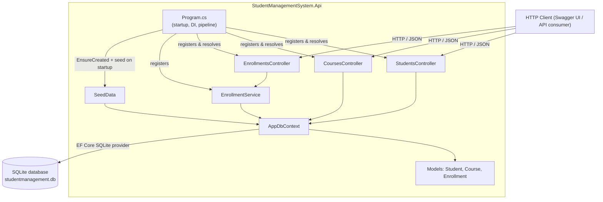

# Architecture Overview

This document gives a new developer a map of how `StudentManagementSystem` works: the
main components, how a request travels from an API endpoint down to the database, and
where to look when making changes.

It reflects the code as it exists today. If you refactor the architecture (for example,
moving business logic out of controllers and into services — see the "Known upcoming
changes" section below), update this document as part of that change.

## 1. Solution layout

```
StudentManagementSystem.sln
src/
  StudentManagementSystem.Api/
    Controllers/   StudentsController, CoursesController, EnrollmentsController
    Services/      IEnrollmentService, EnrollmentService
    Models/        Student, Course, Enrollment (EF Core entities)
    Data/          AppDbContext, SeedData
    Program.cs     App startup / composition root
tests/
  StudentManagementSystem.Tests/   xUnit test project
```

There is a single ASP.NET Core Web API project (`StudentManagementSystem.Api`) and a
single xUnit test project (`StudentManagementSystem.Tests`) that references it.

## 2. Main components and responsibilities

### `Program.cs`
The composition root. It:
- Registers MVC controllers (`AddControllers`), configuring the JSON serializer to
  ignore reference cycles (needed because `Student` ↔ `Enrollment` ↔ `Course` form a
  cycle).
- Registers Swagger/OpenAPI (`AddSwaggerGen`, `UseSwagger`, `UseSwaggerUI`).
- Registers `AppDbContext` with the SQLite provider, using the `DefaultConnection`
  string from `appsettings.json`.
- On startup, calls `Database.EnsureCreated()` and `SeedData.Initialize(context)` so the
  SQLite database file exists and contains sample data on first run.
- Wires the HTTP pipeline: HTTPS redirection, authorization middleware, and controller
  routing (`MapControllers`).

### Controllers (`Controllers/`)
Three controllers, one per resource:

- **`StudentsController`** (`api/students`) — CRUD for students. Injected with
  `AppDbContext` directly.
- **`CoursesController`** (`api/courses`) — CRUD for courses. Injected with
  `AppDbContext` directly.
- **`EnrollmentsController`** (`api/enrollments`) — create an enrollment, list a
  student's courses, list a course's students, remove an enrollment. Injected with
  `IEnrollmentService` and contains no data-access code of its own; it only maps the
  service's result to the appropriate HTTP status code and body.

`StudentsController` and `CoursesController` still contain their business logic
directly (query construction, lookups, persistence) alongside HTTP concerns — see
"Known upcoming changes" for the planned extraction into services for those two.

### Services (`Services/`)
- **`IEnrollmentService` / `EnrollmentService`** — the first service layer introduced in
  the solution. Owns all enrollment business rules: verifying the student and course
  exist, rejecting duplicate enrollments, enforcing `Course.MaxCapacity`, and persisting
  or removing `Enrollment` rows. It depends on `AppDbContext` and is registered as a
  scoped service in `Program.cs`. `EnrollmentsController` depends only on
  `IEnrollmentService`, not on `AppDbContext`.

### Models (`Models/`)
Plain EF Core entity classes:

- **`Student`** — `Id`, `FirstName`, `LastName`, `Email`, and a navigation collection of
  `Enrollments`.
- **`Course`** — `Id`, `Name`, `Description`, `MaxCapacity`, and a navigation collection
  of `Enrollments`.
- **`Enrollment`** — the join entity between `Student` and `Course`, with `StudentId`,
  `CourseId`, navigation properties to each, and `EnrollmentDate`.

`MaxCapacity` on `Course` is enforced by `EnrollmentService`, which rejects new
enrollments once the course is full.

### Data access (`Data/`)
- **`AppDbContext`** — the single EF Core `DbContext`, exposing `DbSet<Student>`,
  `DbSet<Course>`, and `DbSet<Enrollment>`. `OnModelCreating` configures the two
  foreign-key relationships for `Enrollment` (`Student` and `Course`).
- **`SeedData`** — a static helper called once at startup. If the `Students` or
  `Courses` tables are non-empty it does nothing; otherwise it inserts a fixed set of
  students, courses, and enrollments so a fresh database has sample data to explore via
  Swagger.

### Database
SQLite, accessed only through EF Core. The connection string
(`Data Source=studentmanagement.db`) is defined in
`src/StudentManagementSystem.Api/appsettings.json`. The database file is created next to
the running process; deleting it and restarting the app recreates and reseeds it.

## 3. Component diagram



## 4. Request path: from endpoint to database

`StudentsController` and `CoursesController` talk to `AppDbContext` directly
(synchronously, via LINQ-to-Entities) and translate the result into an HTTP response —
for these two, "controller logic" and "business logic" are still the same code.
`EnrollmentsController` instead delegates all business rules and data access to
`EnrollmentService`, and only translates the service's result into an HTTP response.

Example — `POST /api/enrollments` (`EnrollmentsController.Enroll`):

```mermaid
sequenceDiagram
    participant C as Client
    participant MVC as ASP.NET Core MVC routing
    participant EC as EnrollmentsController
    participant ES as EnrollmentService
    participant DB as AppDbContext (EF Core)
    participant SQLite as SQLite database

    C->>MVC: POST /api/enrollments { studentId, courseId }
    MVC->>EC: bind body to EnrollmentRequest, invoke Enroll(request)
    EC->>ES: Enroll(studentId, courseId)
    ES->>DB: Students.Find(studentId)
    DB->>SQLite: SELECT ... WHERE Id = @studentId
    SQLite-->>DB: student row (or none -> StudentNotFound)
    ES->>DB: Courses.Find(courseId)
    DB->>SQLite: SELECT ... WHERE Id = @courseId
    SQLite-->>DB: course row (or none -> CourseNotFound)
    ES->>DB: check duplicate enrollment and course capacity
    DB-->>ES: AlreadyEnrolled / CourseAtCapacity, or none
    ES->>DB: Enrollments.Add(enrollment); SaveChanges()
    DB->>SQLite: INSERT INTO Enrollments (...)
    SQLite-->>DB: rows affected
    DB-->>ES: tracked Enrollment entity
    ES-->>EC: EnrollResult (Created + Enrollment)
    EC-->>C: 201 Created + Enrollment body
```

The `Students` and `Courses` endpoints still follow the controller → `AppDbContext` →
SQLite pattern directly: simple lookups use `Find`/`Single`/`FirstOrDefault`, writes call
`Add`/`Remove` followed by `SaveChanges()`, and the controller maps the outcome to `Ok`,
`NotFound`, `CreatedAtAction`, `NoContent`, or `StatusCode(201, ...)`.

Note that database calls are currently synchronous (`Single`, `ToList`, `SaveChanges`)
rather than using the `async` EF Core APIs.

## 5. Enrollment logic today

Enrollment-related business logic lives in `EnrollmentService`
(`src/StudentManagementSystem.Api/Services/EnrollmentService.cs`); the controller only
maps its results to HTTP responses:

- **Create** (`POST /api/enrollments`) — looks up the student by id (`404` if missing),
  looks up the course by id (`404` if missing), rejects the request if the student is
  already enrolled in the course (`409`), rejects it if the course has reached
  `MaxCapacity` (`409`), otherwise creates an `Enrollment` row with
  `EnrollmentDate = DateTime.UtcNow` and saves it (`201` with the created `Enrollment`).
  A `DbUpdateException` from the unique `(StudentId, CourseId)` index on a concurrent
  duplicate insert is caught and also reported as the duplicate-enrollment conflict.
- **List a student's courses** (`GET /api/enrollments/students/{studentId}/courses`) —
  queries `Enrollments` filtered by `StudentId` and projects to `Course`.
- **List a course's students** (`GET /api/enrollments/courses/{courseId}/students`) —
  queries `Enrollments` filtered by `CourseId` and projects to `Student`.
- **Remove an enrollment**
  (`DELETE /api/enrollments/students/{studentId}/courses/{courseId}`) — looks up the
  matching `Enrollment` row and removes it; the controller returns `404` if none exists,
  otherwise `204`.

## 6. Known upcoming changes (keep this document in sync)

The following change is tracked as a separate issue and will affect this document when
implemented. Update the relevant section above when it lands:

- Extracting business logic out of `StudentsController` and `CoursesController` into
  dedicated services, following the pattern already established by
  `EnrollmentService` (changes sections 2 and 4 — those two controllers would stop
  depending on `AppDbContext` directly).

## 7. Important files

| File | Purpose |
|---|---|
| `StudentManagementSystem.sln` | Solution file referencing both projects. |
| `src/StudentManagementSystem.Api/Program.cs` | App startup, DI registration, HTTP pipeline. |
| `src/StudentManagementSystem.Api/Controllers/*.cs` | HTTP endpoints; business logic for `Students`/`Courses`, HTTP mapping only for `Enrollments`. |
| `src/StudentManagementSystem.Api/Services/*.cs` | Enrollment business logic (first service layer in the solution). |
| `src/StudentManagementSystem.Api/Models/*.cs` | EF Core entities. |
| `src/StudentManagementSystem.Api/Data/AppDbContext.cs` | `DbContext` and entity relationship configuration. |
| `src/StudentManagementSystem.Api/Data/SeedData.cs` | Deterministic sample data inserted on first run. |
| `src/StudentManagementSystem.Api/appsettings.json` | Connection string and logging configuration. |
| `tests/StudentManagementSystem.Tests/` | xUnit test project for the API. |

## 8. Development commands

Run from the repository root:

```bash
# Restore dependencies
dotnet restore

# Build the solution
dotnet build StudentManagementSystem.sln --no-restore

# Run tests
dotnet test StudentManagementSystem.sln --no-build

# Run the API
dotnet run --project src/StudentManagementSystem.Api
```

Once running, Swagger UI is available at `http://localhost:<port>/swagger` for exploring
and trying the endpoints (see `src/StudentManagementSystem.Api/Properties/launchSettings.json`
for the configured ports).

To reset the database, stop the application and delete
`src/StudentManagementSystem.Api/studentmanagement.db` (or wherever it was created
relative to the working directory); it is recreated and reseeded on the next run.
