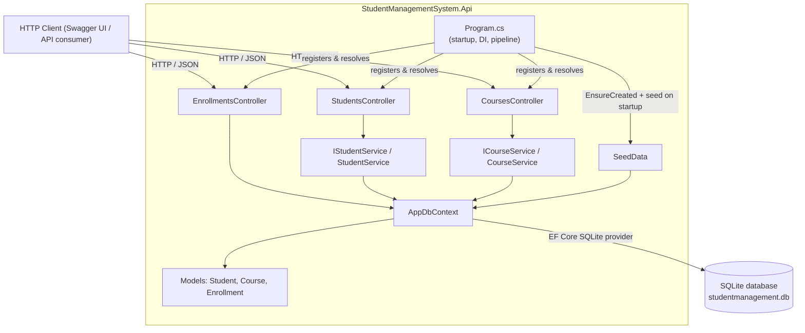

# Architecture Overview

This document gives a new developer a map of how `StudentManagementSystem` works: the
main components, how a request travels from an API endpoint down to the database, and
where to look when making changes.

It reflects the code as it exists today. If you refactor the architecture (for example,
moving business logic out of controllers and into services — see the "Known upcoming
changes" section below), update this document as part of that change.

## 1. Solution layout

```
StudentManagementSystem.sln
src/
  StudentManagementSystem.Api/
    Controllers/   StudentsController, CoursesController, EnrollmentsController
    Services/      IStudentService, StudentService, ICourseService, CourseService
    Models/        Student, Course, Enrollment (EF Core entities)
    Data/          AppDbContext, SeedData
    Program.cs     App startup / composition root
tests/
  StudentManagementSystem.Tests/   xUnit test project
```

There is a single ASP.NET Core Web API project (`StudentManagementSystem.Api`) and a
single xUnit test project (`StudentManagementSystem.Tests`) that references it.

## 2. Main components and responsibilities

### `Program.cs`
The composition root. It:
- Registers MVC controllers (`AddControllers`), configuring the JSON serializer to
  ignore reference cycles (needed because `Student` ↔ `Enrollment` ↔ `Course` form a
  cycle).
- Registers Swagger/OpenAPI (`AddSwaggerGen`, `UseSwagger`, `UseSwaggerUI`).
- Registers `AppDbContext` with the SQLite provider, using the `DefaultConnection`
  string from `appsettings.json`.
- On startup, calls `Database.EnsureCreated()` and `SeedData.Initialize(context)` so the
  SQLite database file exists and contains sample data on first run.
- Wires the HTTP pipeline: HTTPS redirection, authorization middleware, and controller
  routing (`MapControllers`).

### Controllers (`Controllers/`)
Three controllers, one per resource:

- **`StudentsController`** (`api/students`) — CRUD for students. Injected with
  `IStudentService` and contains no data-access code of its own; it only maps the
  service's result to the appropriate HTTP status code and body.
- **`CoursesController`** (`api/courses`) — CRUD for courses. Injected with
  `ICourseService`, same shape as `StudentsController`.
- **`EnrollmentsController`** (`api/enrollments`) — create an enrollment, list a
  student's courses, list a course's students, remove an enrollment. Still injected
  with `AppDbContext` directly and contains its business logic inline (see "Known
  upcoming changes").

### Services (`Services/`)
- **`IStudentService` / `StudentService`** and **`ICourseService` / `CourseService`** —
  own the lookups and persistence for students and courses respectively (`GetAll`,
  `GetById`, `Create`, `Update`, `Delete`). Each depends on `AppDbContext` and is
  registered as a scoped service in `Program.cs`. `StudentsController` and
  `CoursesController` depend only on their respective service interface, not on
  `AppDbContext`.

### Models (`Models/`)
Plain EF Core entity classes:

- **`Student`** — `Id`, `FirstName`, `LastName`, `Email`, and a navigation collection of
  `Enrollments`.
- **`Course`** — `Id`, `Name`, `Description`, `MaxCapacity`, and a navigation collection
  of `Enrollments`.
- **`Enrollment`** — the join entity between `Student` and `Course`, with `StudentId`,
  `CourseId`, navigation properties to each, and `EnrollmentDate`.

`MaxCapacity` exists on `Course` but is not currently enforced anywhere — nothing stops
an enrollment from being created once a course is full (see "Known upcoming changes").

### Data access (`Data/`)
- **`AppDbContext`** — the single EF Core `DbContext`, exposing `DbSet<Student>`,
  `DbSet<Course>`, and `DbSet<Enrollment>`. `OnModelCreating` configures the two
  foreign-key relationships for `Enrollment` (`Student` and `Course`).
- **`SeedData`** — a static helper called once at startup. If the `Students` or
  `Courses` tables are non-empty it does nothing; otherwise it inserts a fixed set of
  students, courses, and enrollments so a fresh database has sample data to explore via
  Swagger.

### Database
SQLite, accessed only through EF Core. The connection string
(`Data Source=studentmanagement.db`) is defined in
`src/StudentManagementSystem.Api/appsettings.json`. The database file is created next to
the running process; deleting it and restarting the app recreates and reseeds it.

## 3. Component diagram



## 4. Request path: from endpoint to database

`StudentsController` and `CoursesController` receive the HTTP request, delegate to
`IStudentService`/`ICourseService`, and translate the service's return value into an
HTTP response — they contain no EF Core code themselves. `EnrollmentsController` still
talks to `AppDbContext` directly (synchronously, via LINQ-to-Entities) and translates
the result into an HTTP response itself; "controller logic" and "business logic" remain
the same code there (see "Known upcoming changes").

Example — `POST /api/enrollments` (`EnrollmentsController.Enroll`):

```mermaid
sequenceDiagram
    participant C as Client
    participant MVC as ASP.NET Core MVC routing
    participant EC as EnrollmentsController
    participant DB as AppDbContext (EF Core)
    participant SQLite as SQLite database

    C->>MVC: POST /api/enrollments { studentId, courseId }
    MVC->>EC: bind body to EnrollmentRequest, invoke Enroll(request)
    EC->>DB: Students.Single(s => s.Id == request.StudentId)
    DB->>SQLite: SELECT ... WHERE Id = @studentId
    SQLite-->>DB: student row
    EC->>DB: Courses.Single(c => c.Id == request.CourseId)
    DB->>SQLite: SELECT ... WHERE Id = @courseId
    SQLite-->>DB: course row
    EC->>DB: Enrollments.Add(enrollment); SaveChanges()
    DB->>SQLite: INSERT INTO Enrollments (...)
    SQLite-->>DB: rows affected
    DB-->>EC: tracked Enrollment entity
    EC-->>C: 201 Created + Enrollment body
```

`StudentService` and `CourseService` follow the same shape (controller → service →
`AppDbContext` → SQLite, synchronously): simple lookups use `Find`/`ToList`, writes call
`Add`/`Remove` followed by `SaveChanges()`, and the controller maps the service's return
value (`null`/non-null, `true`/`false`) to `Ok`, `NotFound`, `CreatedAtAction`, or
`NoContent`.

Note that database calls are currently synchronous (`Find`, `ToList`, `SaveChanges`)
rather than using the `async` EF Core APIs, for both the services and
`EnrollmentsController`.

## 5. Enrollment logic today

Enrollment-related behavior lives entirely in `EnrollmentsController`
(`src/StudentManagementSystem.Api/Controllers/EnrollmentsController.cs`):

- **Create** (`POST /api/enrollments`) — looks up the student and course by id (throws
  if either is missing, since `Single` has no fallback), creates an `Enrollment` row
  with `EnrollmentDate = DateTime.UtcNow`, and saves it. It does not currently check for
  duplicate enrollments or course capacity.
- **List a student's courses** (`GET /api/enrollments/students/{studentId}/courses`) —
  queries `Enrollments` filtered by `StudentId` and projects to `Course`.
- **List a course's students** (`GET /api/enrollments/courses/{courseId}/students`) —
  queries `Enrollments` filtered by `CourseId` and projects to `Student`.
- **Remove an enrollment**
  (`DELETE /api/enrollments/students/{studentId}/courses/{courseId}`) — looks up the
  matching `Enrollment` row and removes it, returning `404` if none exists.

This logic is intentionally simple today and is expected to change (see below).

## 6. Known upcoming changes (keep this document in sync)

The following changes are tracked as separate issues and will affect this document when
implemented. Update the relevant section above when any of these land:

- Preventing duplicate enrollments and enforcing `Course.MaxCapacity` when creating an
  enrollment (changes section 5's "Create" behavior).
- Returning consistent `404` responses for missing students/courses instead of letting
  lookups throw (changes sections 4 and 5).
- Extracting business logic out of `EnrollmentsController` into a dedicated service,
  following the pattern already established by `StudentService`/`CourseService`
  (changes sections 2, 3, and 4 — `EnrollmentsController` would stop depending on
  `AppDbContext` directly).

## 7. Important files

| File | Purpose |
|---|---|
| `StudentManagementSystem.sln` | Solution file referencing both projects. |
| `src/StudentManagementSystem.Api/Program.cs` | App startup, DI registration, HTTP pipeline. |
| `src/StudentManagementSystem.Api/Controllers/*.cs` | HTTP endpoints; business logic for `Enrollments`, HTTP mapping only for `Students`/`Courses`. |
| `src/StudentManagementSystem.Api/Services/*.cs` | Student and course business logic. |
| `src/StudentManagementSystem.Api/Models/*.cs` | EF Core entities. |
| `src/StudentManagementSystem.Api/Data/AppDbContext.cs` | `DbContext` and entity relationship configuration. |
| `src/StudentManagementSystem.Api/Data/SeedData.cs` | Deterministic sample data inserted on first run. |
| `src/StudentManagementSystem.Api/appsettings.json` | Connection string and logging configuration. |
| `tests/StudentManagementSystem.Tests/` | xUnit test project for the API. |

## 8. Development commands

Run from the repository root:

```bash
# Restore dependencies
dotnet restore

# Build the solution
dotnet build StudentManagementSystem.sln --no-restore

# Run tests
dotnet test StudentManagementSystem.sln --no-build

# Run the API
dotnet run --project src/StudentManagementSystem.Api
```

Once running, Swagger UI is available at `http://localhost:<port>/swagger` for exploring
and trying the endpoints (see `src/StudentManagementSystem.Api/Properties/launchSettings.json`
for the configured ports).

To reset the database, stop the application and delete
`src/StudentManagementSystem.Api/studentmanagement.db` (or wherever it was created
relative to the working directory); it is recreated and reseeded on the next run.
